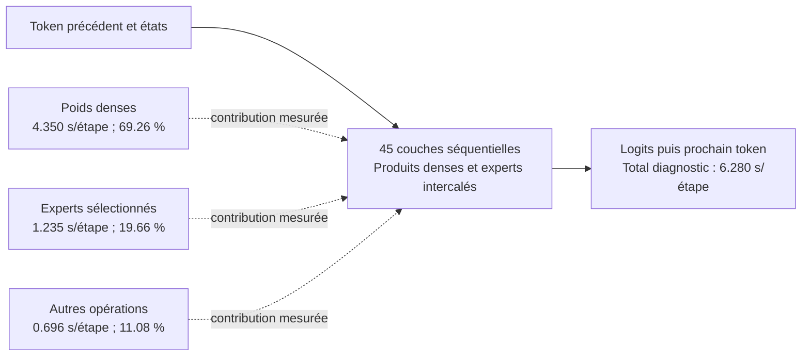

# Notes quantitatives de faisabilité — métadonnées sauvegardées

Ce document est généré par `feasibility.py`, sans accès aux poids ni inférence. Les données d'entrée sont des diagnostics sérialisés et ne constituent pas un benchmark de production.

3 étapes de décodage ; 6.280405 s de temps mur d'opérations par étape, hors inspection.

| Groupe intercalé dans les couches | Secondes/étape | Part du diagnostic | Go logiques connus/étape |
|---|---:|---:|---:|
| Produits de poids denses | 4.349771 | 69.26 % | 9.444458 |
| Produits des experts sélectionnés | 1.234757 | 19.66 % | 2.774532 |
| Autres opérations / non attribuées | 0.695878 | 11.08 % | 0.000000 |

Le tableau partitionne le temps mur de ce diagnostic ; il ne sépare pas l'I/O et le calcul. Les temps CPU additionnent les threads. Les soustraire du temps mur n'a pas de sens physique. Les opérations sont intercalées, et les captures peuvent perturber l'ordonnancement.

## Sensibilité conditionnelle pour une interface à 1 Go/s

Le plan source d'une capture complète distincte établit entre 12,218,990,592 et 12,218,990,592 octets de poids distincts déclarés par étape de décodage. L'union valide les noms, codecs, formes, strides, limites et routes canoniques du graphe capturé. Elle n'établit ni des transferts SSD ni un minimum pour tous les algorithmes possibles. Le tableau utilise le minimum U de ces étapes. Le profil temporel ci-dessus reste une observation séparée.

Si U octets distincts sont nécessaires pour chaque token et si toutes les strates de cache couvrent ensemble au plus C de ces octets au début du token, au moins max(U−C,0) octets doivent traverser l'interface de stockage. Le débit ne peut alors dépasser B/max(U−C,0), même avec calcul et chevauchement idéaux. B doit être un plafond de service établi séparément. C est une couverture en octets d'origine, incluant les données compressées et caches auxiliaires, pas un RSS interchangeable.

| Couverture retenue C (Gio) | Minimum conditionnel à transférer (Go/token) | Plafond I/O seul conditionnel (tok/s) |
|---|---:|---:|
| 0 | 12.218991 | 0.081840 |
| 1 | 11.145249 | 0.089724 |
| 2 | 10.071507 | 0.099290 |
| 3 | 8.997765 | 0.111139 |
| 4 | 7.924023 | 0.126199 |
| 6 | 5.776540 | 0.173114 |
| 8 | 3.629056 | 0.275554 |

| Cible de débit (tok/s) | Couverture retenue nécessaire au minimum (Go) | Même couverture (Gio) |
|---|---:|---:|
| 0.5 | 10.218991 | 9.517177 |
| 1 | 11.218991 | 10.448499 |
| 3 | 11.885657 | 11.069381 |
| 5 | 12.018991 | 11.193557 |

Ces couvertures sont nécessaires sous les hypothèses B/U indiquées, avant coût CPU/GPU, latences, synchronisations et réserve mémoire de sécurité. Elles ne constituent pas des allocations autorisées ou démontrées faisables.

Aucune borne de débit inconditionnelle n'est établie par les seules sommes logiques. Les lectures OS, les transferts du contrôleur et les lectures NAND restent des quantités distinctes. Les budgets du tableau sont des scénarios ; leur faisabilité mémoire n'est pas présumée.

Un gain de 20 % exige de retirer au moins 16.667 % du chemin critique initial, soit 1.046734 s/étape dans ce diagnostic. Un cache ne retire ce temps que s'il évite des accès coûteux réellement situés sur ce chemin.

Correction de la mission : 0,551 ms correspond au **GPU serial32**, pas au CPU série. La référence native CPU10 mesurée sur ce groupe est 0,664 ms ; les temps GPU command-buffer et mur MLX ont des périmètres différents.
