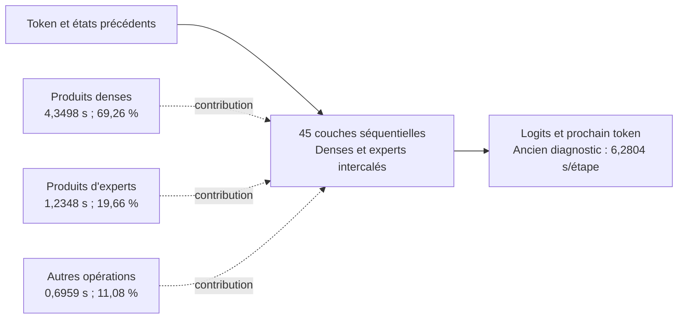

# GLM-5.3 Flash sur M5 : streaming dense, fidélité et capacité réelle

**Reprise du 3 novembre :** fidélité étendue à 32 étapes pour CPU +
`MAP_NOCACHE` et tail12 ; conversation CPU + nocache terminée à EOS sur
88 IDs ; remise à zéro native 2×4 vérifiée. Les nouveaux essais GPU longs
s'arrêtent sur le swap et ne démontrent aucun gain soutenu. Le probe réel
agents 1/600 est interrompu par un passage secteur→batterie après une seule
sortie partielle. Le meilleur gain répété reste **+9,14 % sur huit sorties**.
Voir le [rapport autonome de reprise et ses limites](REPRISE.md).

Rapport de la campagne finale, 2–3 novembre 2026. Branche
`research/glm53-m5-dense-stream-final`, basée sur la PR #19, commit
`fc59b4b80a526e98b56ec918dc51c9649c4c1181`. Runtime llama.cpp épinglé à
`3f8af15a76ac8675812e856da45454bafc90f12c`. Aucune fusion dans `main`.

Cette campagne traite d'abord les poids denses : ils représentent 77,3 % des
octets d'opérandes de multiplication inspectés. Elle ajoute un préchargement
mmap borné, un réglage expérimental du descripteur de mapping, une observation
plus précise de la mémoire/I/O et de nouvelles preuves de fidélité du runtime
reconstruit. Les résultats de fidélité, les mesures de composants et les
campagnes de débit sont présentés séparément. Aucun palier de débit ne découle
de la seule existence d'un kernel GPU ou d'un cache simulé.

## Environnement et contraintes conservées

MacBook Air Apple M5, GPU huit cœurs, 16 Gio de mémoire unifiée, macOS 27.2,
SDK sélectionné 27.2. Checkpoint original GLM-5.3 Flash GGUF Q2_K_S :
**110 027 352 864 octets** en deux shards. Le premier shard de 9 430 112
octets contient les métadonnées/tokenizer ; le second contient les poids.

Le checkpoint testé est sur le SSD interne APFS. Le Fanxiang PS1008 n'était
pas monté ; `/Volumes/SSD` était un répertoire du volume interne. Aucun résultat
n'est attribué au disque externe. Le scénario « interface à 1 Go/s » est un
calcul conditionnel, pas une mesure du Fanxiang.

Les poids et leur quantification restent inchangés. Les exécutions enregistrent
tailles et dates de modification des shards, hashes des bibliothèques et des
octets de composants sélectionnés. Aucun nouveau hash intégral de 110 Go
n'est revendiqué. Les limites restent **8,5 Gio de RSS**, **32 Mio de croissance
globale du swap**, arrêt sur pression critique, erreur de mesure ou timeout.
Le benchmark serveur impose aussi 256 Mio de mémoire disponible ; ce seuil
supplémentaire n'est pas présent dans le superviseur natif de capture.

RONIN conserve ses **600 agents logiques, un slot physique partagé/adaptatif,
les interfaces et le backend CPU10/GPU0 de secours**. Les agents logiques
n'allouent pas chacun une instance du modèle. Le nouveau worker de lecture est
unique dans le processus, indépendamment du nombre d'agents logiques.

## Hypothèses, instrumentation et résultats établis

| Quantité | Source et portée | Ce qui reste inconnu |
|---|---|---|
| Octets d'opérandes distincts | Noms/types/formes/strides/offsets natifs joints aux headers GGUF et aux routes de la même capture | Instructions de chargement effectivement exécutées ; trafic physique |
| Lectures OS du processus, pageins, fautes, temps CPU | `libproc` sur le PID possédé, identité vérifiée | NAND, cache hits exacts, attentes pures des poids |
| Catégories mémoire du moteur | Auto-observation native `TASK_VM_INFO` dans la capture D où disponible | Anciennes captures A/B/C sans cette extension ; device ne couvre pas tout le pinning GPU |
| Wired, mémoire physique du compresseur, pages de fichiers, swap, pression | Compteurs système macOS, snapshots horodatés | Attribution exacte à une application ; catégories à ne pas additionner aveuglément |
| Lectures de bloc | `IOBlockStorageDriver`, système entier | Trafic de périphérique attribué au seul moteur, cellules NAND |
| Temps GPU | Horodatages de command buffers appartenant au moteur | Tous les stalls/copies hôte et compteurs par kernel |
| Temps par opération | Callback natif sérialisé, ancien profil CPU | Décomposition exacte calcul/I/O/synchronisation de la production |

Les valeurs indisponibles restent nulles. `faults − pageins` n'est pas un taux
de hits ; octets logiques moins lectures OS n'est pas une mesure du cache de
fichiers. Le temps CPU somme les threads et peut dépasser le temps mur.
Le pourcentage GPU système inclut le bureau et les autres applications.
`fs_usage` exigeait les droits root : aucune trace privilégiée n'a été collectée
ou substituée à ces compteurs. Voir [portée des observateurs](MEMORY_IO.md).

La dernière auto-observation D donne notamment 6 132 383 744 octets résidents,
6 081 839 104 octets externes, 318 472 192 octets comprimés et une footprint
OS de 443 851 424 octets. Ces catégories ne s'additionnent pas comme des
allocations indépendantes. Une valeur `device=0` n'établit pas l'absence de
mémoire GPU épinglée. Les captures A/B/C plus anciennes ne reçoivent pas
rétroactivement ces champs ; une mesure Python de soi-même ne leur est pas
substituée. Le plafond RSS inclut les mappings de fichiers, pas seulement la
mémoire anonyme privée.

### Identité des poids denses et des experts

La [preuve d'union source](evidence/cpu-stream16-source-union-requests.json)
ferme l'ancien écart d'identité du simple multiensemble de tailles. Sur chaque
étape décodée de la capture B16, les **684 matrices fixes** et **126 banques
d'experts** sont jointes exactement à l'inventaire. Les plages sont validées
par codec, forme, stride, alias, offset et limite du fichier, puis réunies sans
padding et sans compter deux fois les recouvrements. Les experts sont ceux des
top-8 canoniques de cette même étape ; aucune prédiction future n'est utilisée.

| Opérandes du graphe inspectés | Octets distincts par étape décodée | Part |
|---|---:|---:|
| Matrices denses fixes | 9 444 458 496 | 77,2933 % |
| Gate/up/down des experts sélectionnés | 2 774 532 096 | 22,7067 % |
| Total ciblé | **12 218 990 592** | 100 % |

Ces volumes sont identiques sur les quinze étapes décodées après le préfill.
Ils ne sont pas des lectures SSD : des octets requis peuvent être résidents,
compressés ou satisfaits par un cache. Ils ne constituent pas davantage un
minimum informationnel pour tout algorithme possible. L'union concerne les
opérandes MUL_MAT/MUL_MAT_ID de cette implémentation ; normes, embeddings,
états et copies intermédiaires ne sont pas inclus dans ce total. L'analyse
offline ne lit aucun payload GGUF. Les vues inconnues refusent une couverture
complète plutôt que d'être remplacées par la banque entière.

### Chemin de dépendances et temps observés



Le diagramme partitionne **trois étapes de l'ancien diagnostic CPU4
sérialisé**, hors 0,2416 s d'inspection par étape. Les groupes sont intercalés
dans le vrai graphe. Le temps de chaque groupe inclut calcul, accès mémoire,
défauts de pages et ordonnancement ; ces pourcentages ne sont pas une séparation
I/O/CPU/GPU et ne sont pas le débit actuel de production. Voir
[faisabilité et limites](FEASIBILITY-CLOSED.md).

## Expériences permettant d'attribuer les coûts

### Même produit dense, première utilisation puis répétitions

Une vraie matrice Q8_0 de **35 651 584 octets**, `blk.0.attn_q.weight`, est
mappée en lecture seule et calculée par GGML CPU10. L'activation réelle vient
de `attn_norm-40` et correspond en largeur ; elle ne rejoue pas l'opération
originale de couche 0. Les 8 192 sorties sont identiques en bits à chaque phase.

| Phase | Produit natif mural | Lectures OS du PID | Pageins du PID |
|---|---:|---:|---:|
| Première utilisation observée | 15,783 ms | 35 672 064 octets | 2 177 |
| Répétition 1 | 0,322 ms | 0 | 0 |
| Répétition 2 | 0,349 ms | 0 | 0 |
| Répétition 3 | 0,314 ms | 0 | 0 |

Le premier passage n'est pas qualifié de physiquement froid. La différence
inclut pages, caches matériels, première allocation éventuelle du workspace
et ordonnancement. Elle établit un fort effet de résidence sur ce composant,
sans attribuer exactement la différence au SSD ni l'extrapoler aux 9,444 Go
du modèle. Pic RSS 42 680 320 octets, croissance du swap nulle.
[Protocole et données](DENSE_COLD_WARM.md).

### Lecture représentative des mêmes 1 Gio denses

Les trois sondes utilisent les mêmes plages, 166 appels et le même hash du
flux lu, avec un scratch de 8 Mio. Elles se terminent sans croissance du swap.

| Mode | Logique | Lectures OS du PID | Lectures de bloc globales | Temps dans read / total |
|---|---:|---:|---:|---:|
| `F_NOCACHE` demandé | 1 073 741 824 o | 1 074 589 696 o | 1 087 467 520 o | 0,1853 / 0,8886 s |
| Normal | 1 073 741 824 o | 1 086 775 296 o | 1 094 934 528 o | 0,1291 / 0,8438 s |
| Normal répété immédiatement | 1 073 741 824 o | 270 336 o | 6 594 560 o | 0,0460 / 0,7504 s |

Le temps total inclut hash et observations. Le quotient logique du premier
essai, **5,79 Go/s**, n'est pas une vitesse SSD certifiée ; celui de la répétition,
23,35 Go/s, ne l'est pas non plus. L'ordre est fixe et le cache antérieur n'est
pas contrôlé. Le faible compteur PID de la répétition soutient un effet du
cache, sans donner un taux exact de hits. Les compteurs contrôleur restent
globaux ; les NAND et les transferts de périphérique par PID restent inconnus.
Preuves brutes : `storage-dense-{nocache-v2,normal,repeat}.json`.

## Implémentations évaluées

**Anticipation dense bornée.** `AIRLLM_DENSE_LOOKAHEAD=1` conseille un préfixe
du prochain poids dense CPU réellement présent dans le graphe. La fenêtre
est 32 Mio par défaut, réglable à 16/32/64/128 Mio ; un seul worker et une
seule tâche sont en vol. Seuls des poids constants `CPU_Mapped`, contigus,
dans les bornes et sur des pages en lecture seule sont admis. La tâche est
omise si le worker reste occupé. Le retour du graphe draine l'appel commencé
avant toute libération de poids. Les graphes concurrents n'ouvrent pas un
second pipeline.

L'admission demande pression normale, au moins 2 Gio + fenêtre de mémoire
reclaimable estimée, et moins de 128 Mio de croissance physique du compresseur
depuis le début du graphe. Une mesure inconnue refuse la tâche. Les compteurs
rapportent conseils, octets conseillés, appels/erreurs, omissions et attente
de fermeture. Un conseil accepté ne prouve ni lecture SSD, ni résidence, ni
chevauchement utile. La fixture réelle passe 26 contrôles et produit les mêmes
sorties CPU ; elle ne remplace pas la campagne complète.
[Mécanisme et preuve](DENSE_LOOKAHEAD.md).

**Mapping à faible localité demandé.** `AIRLLM_MMAP_NOCACHE=1` ajoute
`MAP_NOCACHE` aux flags de `mmap` sur Darwin. Ce mécanisme est distinct du
`F_NOCACHE` de la sonde de lecture ci-dessus. Il ne garantit pas l'état du pager
mmap ou du cache macOS. Ce réglage n'est pas installé dans
RONIN. Les mesures de la combinaison avec anticipation ne séparent pas,
à elles seules, la contribution causale de chacun des deux mécanismes.

**Metal fidèle.** La tête Q8 et le sous-ensemble Q8 de cinq couches utilisent
l'arithmétique temporaire et l'accumulation ARM déjà décrites dans la PR #19.
Les produits multi-colonnes, normalisations, mHC, routage, récurrences/états
KDA et experts Q2 restent CPU. Les matvecs Q8 éligibles peuvent passer sur GPU,
y compris certaines projections Q/K/V au décodage. Le tail5 sélectionne
35 matrices originales, 1 482 883 072 octets ; il ne place pas cinq couches
entières ou leurs banques MoE sur le GPU. La lecture CPU directe de poids
Metal reste limitée aux constantes mappées et VM non inscriptibles.

Le chemin hybride général de la PR #17 reste rejeté : maximum de logits
0,5348455906 et 364 éléments de routes différents, malgré quatre argmax
identiques. La PR #18 a corrigé la désactivation globale d'une fusion mHC
causée par le placement à la frontière CPU/GPU ; le préfixe CPU est alors
rétabli, mais GPU6 demeure divergent. La trace détaillée de la PR #19 localise
une première différence parmi les sorties nommées à RMSNorm HC sur une entrée
identique : accumulation CPU en double contre réduction Metal en FP32.
La projection Q8 suivante dépasse la tolérance. Le CPU quantifie temporairement
l'activation en Q8_0 ; le chemin Metal général consomme du FP32 et ne suit pas
la même réduction. Les effets ne sont pas attribuables à un unique kernel
à partir de cette trace. La voie sélective conserve le placement et l'ordre
arithmétique CPU nécessaires, sans élargir les seuils ni réordonner les routes.
Voir [attribution détaillée](../glm53_gpu_v2/TRACE_FIDELITY.md) et
[contrat Q8](../glm53_gpu_v2/Q8_FIDELITY.md).

Les kernels Q2/MLX et TensorOps précédents restent des preuves de composants.
Correction de la mission : **0,551 ms était le GPU serial32**, pas le CPU série.
Le meilleur temps GPU Q2 de 0,488 ms ne se compare pas directement au temps
mural MLX de 0,671 ms ou au CPU10 de 0,664 ms. Aucun nouveau gain du modèle
n'est déduit de ces nombres ; le CPU demeure le chemin Q2 du moteur évalué.

### Cache partiel et choix des priorités

La rétention d'1 Gio donne +9,63 % uniquement dans un modèle I/O linéaire à
coût uniforme par octet. Un contrôle par coût observé a donc été effectué sur
les 684 produits denses des trois anciennes étapes CPU4. Le modèle permet
même de supprimer **tout** le temps de l'opération retenue, calcul compris,
sans coût de chargement, de copie ou d'éviction.

| Budget de matrices entières | Meilleur choix fixe de sites, gain optimiste | Relaxation encore plus favorable, choix fractionnaire différent par étape |
|---|---:|---:|
| 256 Mio | +5,74 % | +6,30 % |
| 512 Mio | +10,51 % | +11,14 % |
| 1 Gio | +18,53 % | +19,35 % |

La relaxation à 1 Gio supprime 1,018193 s/étape ; +20 % demanderait
1,046734 s sur ce diagnostic. Les petits BF16/F32 et MLA K/V ont le plus
fort coût par octet. Ces coûts comprennent le calcul, que le cache ne supprime
pas. La borne porte sur les économies directes de cet échantillon et de ce
modèle de matrices entières : elle ne borne ni d'autres trajectoires ni les
effets indirects de la résidence sur la pression ou les opérations voisines.
Un gros cache privé doit aussi passer l'admission mémoire, pas seulement ce
calcul optimiste. [Méthodes et contre-interprétations](REPORT-NOTES.md).

Un dernier prototype retient donc les **pages originales** d'un sous-ensemble
F32/BF16, avec `mlock`, sans copie privée des poids. Le plan déterministe
sélectionne 103 matrices : 266 862 592 octets utiles et **268 255 232 octets
de pages entières**, sous le plafond de 256 Mio. Les coûts anciens sont
associés aux nouveaux noms par ordre de graphe et tailles vérifiées ; cela
reste une proposition de sélection, sans trace simultanée nom/pointeur/temps.
Son plafond conditionnel d'économies directes est +5,7094 %, avant le coût réel
de rétention et les effets sur les autres pages.

L'admission vérifie les mappings constants CPU d'origine en lecture seule,
le budget d'union des pages, la limite système existante, la pression normale
et une réserve de 2 Gio. La limite système n'est jamais augmentée. Un seul
propriétaire est permis ; échec ou annulation libèrent les acquisitions
partielles. Un échec de libération bloque toute acquisition ultérieure dans
ce processus. La destruction libère les verrous avant les mappings. La fixture
native passe **48 contrôles**, dont résidence réelle, rollback, concurrence
et ordre de destruction. Cette preuve de composant ne suffit pas à qualifier
un gain du modèle. Voir [conception et reproduction](DENSE_LOCK.md).

### Compression sans perte : piste rejetée dans cette campagne

Huit échantillons, 50,201 Mo au total, ont été compressés par Zstandard niveau 3
puis reconstruits exactement. Ratios taille comprimée/originale : Q8_0
**0,918–0,929**, BF16 **0,778–0,783**, Q2_K **0,977–0,978**. Le décompresseur
chaud produit environ **1,37–1,56 Go originaux/s** dans ce pilote.

Le faible gain Q8/Q2 ne compense pas la décompression séquentielle dans le
scénario à 1 Go/s. Une parfaite superposition modifierait le calcul, mais
exigerait ressources CPU, staging et validation native supplémentaires.
La campagne rejette l'intégration de ce format sur la base de ce pilote,
sans extrapoler un ratio au modèle entier ou exclure tous les codecs parallèles.
Le GGUF n'est pas réécrit. Preuve : `lossless-samples.json` et
[analyse du compromis](REPORT-NOTES.md).

## Fidélité du runtime reconstruit et mémoire observée

Les quinze patches sont compilés dans un runtime isolé. Les quatre voies
ci-dessous utilisent les **mêmes hashes des neuf bibliothèques natives**.
Les tolérances historiques Metal restent `atol=0,001`, `rtol=0,0001`, avec
valeurs finies et routes ordonnées exactes. Les comparaisons ci-dessous font
mieux sur leur trajectoire : zéro différence en bits dans les familles capturées.

| Voie, 16 sorties | Logits | Routes / routeurs / KDA | Écritures d'état observées | Pic RSS échantillonné | Croissance swap |
|---|---:|---|---|---:|---:|
| A, CPU10/GPU0 de contrôle | 2 478 080 exacts face à la référence CPU antérieure | Exacts | 3 792 empreintes de référence finies | 6 679 592 960 o | 0 |
| B, CPU + nocache + anticipation 32 Mio | 2 478 080 exacts | Exacts | 3 792 égales au contrôle | 6 829 850 624 o | 0 |
| C, tête Q8 Metal + chemin B | 2 478 080 exacts | Exacts | 3 792 égales | 6 299 795 456 o | 0 |
| D, tail5 Q8 Metal + chemin B | 2 478 080 exacts | Exacts | 3 792 égales | 6 168 559 616 o | 0 |

Les empreintes SHA-256 concernent les valeurs logiques des écritures CPY et
SET_ROWS reconnues vers les caches, y compris les vues stridées ; 1 088
événements sont vides. Elles ne prouvent pas la parité d'états non observés
ou d'autres formes d'écriture. Le scratch de relecture est borné à 1 Mio.
La référence A capture ces écritures ; l'ancienne référence numérique ne
possédait pas cette couverture et aucune parité rétroactive d'état n'est inventée.

Les captures suivent les entrées de référence et comparent aussi les IDs
générés. Elles peuvent sérialiser et synchroniser l'exécution ; leur durée
n'est jamais convertie en tok/s. La preuve porte sur cette trajectoire et les
bibliothèques enregistrées, pas tous les prompts, les contextes longs ou
chaque requête serveur future. Une modification native impose de nouvelles
preuves ; l'égalité des seuls tokens chronométrés ne les remplace pas.

### Charge normale et isolement autorisé

Avant isolement, le nouveau profil CPU4 a été arrêté avant sa première sortie
pour environ 151 Mio de croissance du swap global ; le contrôle nocache16
s'est arrêté après une sortie pour environ 61 Mio. Ces essais restent
incomplets et rejetés, sans marqueur de fin fabriqué. Le swap étant système,
ils n'attribuent pas cette croissance au seul moteur ou au GPU.

Avec autorisation explicite de l'utilisateur, Music, Creative Cloud et App
Store ont ensuite été quittés normalement, sans arrêt forcé. Certains helpers
restaient présents. Les quatre diagnostics isolés ci-dessus passent leurs
gardes ; cela ne qualifie pas une charge normale identique aux essais précédents
ou une stabilité de plusieurs heures. Le swap préexistant reste non nul.
L'admission conserve ses limites dans les deux conditions.

## Campagnes de débit complet

Les trois cycles V3 A/B/B/A sont complets : deux passages par bras,
huit sorties par passage, mêmes IDs et arrêt sur limite dans les douze cas.
Ils utilisent les neuf bibliothèques V3 qualifiées sur seize étapes. Toutes
les gardes passent, avec zéro croissance du swap échantillonnée. Les contrôles
après exécution vérifient aussi sources, binaires et préfixe capturé, sans
modifier les JSON d'origine.

| Candidat V3 | CPU A médian, tok/s | Candidat médian, tok/s | Écart décodage | TTFT A / candidat |
|---|---:|---:|---:|---:|
| CPU + nocache + anticipation32 | 0,137903 | 0,137456 | **−0,324 %** | 23,024 /22,207 s |
| Tête Q8 Metal + streaming | 0,141111 | 0,147903 | **+4,814 %** | 22,466 /21,784 s |
| Tail5 Q8 Metal + streaming | 0,138792 | 0,151471 | **+9,136 %** | 22,801 /21,721 s |

Chaque candidat est comparé à son propre contrôle contemporain. La dérive
CPU entre le premier et le dernier A vaut −8,41 %, −1,02 % et −3,59 %
respectivement ; celle des deux B vaut −8,93 %, +0,21 % et +3,05 %.
Ces deux observations par bras ne donnent pas une distribution générale
ni un intervalle de confiance robuste.

Pour la tête, le temps total médian baisse de 2,88 %, avec chargement
+5,65 %. Pour tail5, il baisse de 6,97 %, avec chargement −5,23 %.
Le bénéfice de décodage ne se confond donc pas avec celui du lancement
complet. Le meilleur passage V3 est tail5 à 0,153745 tok/s ; sa médiane
répétée est 0,151471 tok/s. Le palier +20 % n'est pas atteint par ces essais.

| Requête complète, préfill inclus | Tête : CPU / GPU | Tail5 : CPU / GPU |
|---|---:|---:|
| Lectures OS PID médianes | 116,760 /111,366 Go | 116,761 /104,081 Go |
| Lectures de bloc globales médianes | 118,244 /112,785 Go | 118,292 /105,490 Go |
| Commandes GPU valides observées, par B | 26 | 430 |
| Union GPU des commandes observées, par B | 0,11652–0,11761 s | 0,31397–0,31773 s |

Le PID lit 4,62 % d'octets OS en moins avec la tête et 10,86 % avec tail5.
C'est cohérent avec une réutilisation des matrices placées sur GPU, sans
isoler à elle seule cet effet des autres changements de résidence/ordonnancement.
Les colonnes ne mesurent ni le seul décodage ni les NAND. Le temps GPU est
celui des commandes enregistrées, copies/événements inclus, sans garantie
d'exhaustivité ; il ne donne pas tout le temps de calcul ou d'attente GPU.
La température en degrés et une séparation pure attente/calcul restent
indisponibles. Les tables par passage, mémoires, défauts de pages, temps
CPU convertis avec la timebase mesurée, limites et SHA sont dans
[les résultats V3 détaillés](PERFORMANCE-V3.md).


Le protocole utilise des serveurs neufs, CPU10, contexte 512, batch/microbatch
8, le même prompt de six tokens `La capitale de la France est`, température 0,
seed 42, sans réutilisation KV. Le décodage observé vaut
`(N−1)/(instant dernier token − instant premier token)` ; chargement et TTFT
sont séparés. Les limites de sorties et les terminaisons réelles restent visibles.

Le pilote de campagne exige des preuves A et candidat d'au moins seize étapes,
les mêmes bibliothèques, modèle, prompt et politiques, et une preuve des états
observés du candidat. Il vérifie les identités avant chaque étape, sauvegarde
le plan avant lancement et s'arrête sur défaillance. Les voies GPU exigent des
commandes GPU terminées réellement observées. Les fichiers existants ne sont
pas écrasés ; les processus possédés sont nettoyés avec identité vérifiée.
Les callbacks de capture ne sont pas activés dans les mesures serveur.

Le cache de fichiers et la charge d'arrière-plan ne sont pas contrôlés.
ABBA réduit certains biais sans les supprimer. Les anciens
0,1085–0,1664 tok/s sont historiques ; ils ne servent pas de dénominateur à un
gain actuel. Une campagne de quelques passages ne certifie pas la variance
générale ou la stabilité thermique durable.

### Reconstruction V4 et cycle avec cache dense

La recette complète optionnelle à seize patches a été exécutée sur ce M5.
Le V4 possède dix bibliothèques régulières, dont celle de completion absente
auparavant du dossier V3 ; les empreintes V3 ne lui sont pas transférées.
Un nouveau contrôle CPU16 puis tail5+cache256 reproduisent chacun les
**2 478 080 logits, routes/routeurs/KDA et 3 792 écritures observées** en bits.
Pics RSS : 6 426 984 448 et 6 301 024 256 octets ; croissance du swap nulle.
Les 103 matrices et 268 255 232 octets verrouillés sont effectivement vérifiés.
Les treize sources natives modifiées ou nouvelles, headers inclus, sont
empreintées dans le checkout compilé puis reconstruites à l'identique.
[Preuves V4](FIDELITY-V4.md).

Le cycle V4 A/B/B/A suivant se termine, mais **sa comparaison de performances
est invalide**. Deux passages candidats traversent quatorze entrées en veille
et leurs réveils de maintenance. Leurs durées civiles valent 5 911,97 et
1 640,28 s, contre 163,38 et 287,49 s sur le chronomètre actif. Le −23,94 %
calculé par l'ancien pilote reste dans les données brutes et ne démontre
**ni gain ni régression du cache**. Le dernier contrôle CPU est lui aussi dans
le contexte de réveil de maintenance. La croissance du swap maximale est
22 740 992 octets, sous sa garde ; cela ne rend pas la comparaison valide.

L'audit confirme à l'inverse la continuité des douze passages V3 : écart
civil/chronomètre de 0,0434–0,0553 s, aucune veille dans leurs intervalles,
fin du dernier passage avant la première veille. Les preuves numériques
V4 sont indépendantes de ces durées et ne deviennent pas des mesures de débit.
[Audit des horloges et événements](POWER-CONTINUITY.md).

Le pilote corrigé refuse désormais un Mac fermé ou un état inconnu avant
lancement, vérifie une source d'alimentation constante et rejette un écart
horloge civile/active supérieur à deux secondes. Une assertion temporaire
empêche la seule veille d'inactivité pendant le serveur possédé ; elle ne
contourne pas la fermeture du couvercle et ne change aucun réglage permanent.
Il exige aussi une sortie native normale et un transcript complet : arrêt
sur limite avec le nombre demandé, ou EOS cohérent avec tous les IDs prédits.
Un flux UTF-8 qui omet des IDs est refusé, sans inventer un EOS manquant.

Ces conditions fermées appartiennent à la phase initiale. Après ouverture
du Mac, les deux reprises du cache restent rejetées : transition
batterie→secteur avant sortie, puis admission des pages refusée avec annulation
de tous les verrous. Aucun gain du cache n'est établi.

Les nouvelles captures CPU + nocache et tail12 + streaming reproduisent
chacune **4 956 160 logits finis, routes/routeurs/KDA et 7 584 écritures
observées** sur 32 étapes de référence. Tail12 sélectionne 82 matrices Q8
originales, 2 592 538 624 octets ; ce n'est pas tout Q8 ni douze couches
entières. Son ABBA32 s'arrête au premier B sur le swap après 13 sorties.
La répétition CPU32 indépendante échoue avant sortie ; le dernier pilote
tail5/V4 est également arrêté sur le swap après cinq sorties. Aucun ABBA
tail5 long n'est lancé, aucune divergence arithmétique n'est déduite d'une
capture incomplète. Le plan ABBA32 initial reste explicitement A16/B32 ;
aucune qualification CPU32 répétée n'est ajoutée rétroactivement.

CPU + nocache atteint un EOS réel sur une conversation courte de 88 IDs,
réponse finale `OK`, puis passe une remise à zéro native 2×4 : quatre paires
de logits et 948 écritures observées par requête identiques. Ces preuves
restent distinctes de la fidélité des 88 étapes, de sessions RONIN et d'un
gain de vitesse. Le probe agents 1/600 enregistre 600 identités et réutilise
le même serveur ; seul l'agent 1 émet un token `</think>` sur limite, après
447 entrées natives et 937,169 s de préparation. La deuxième requête est
annulée par le garde secteur→batterie, sans terminal ni qualification globale.
Tous ses processus possédés sont arrêtés. [Données de reprise](REPRISE.md).

## Capacité physique : ce que les chiffres permettent de conclure

Un cache des huit experts précédents dans chacune des 42 couches occuperait
**2 774 532 096 octets**. Sur les quatorze transitions entre tokens décodés,
il réutilise **2 218 / 4 704 demandes, 47,1514 %**, contre zéro hit au décodage
pour le LRU global de 128 Mio. Les capacités diffèrent ; ce n'est pas une
comparaison de performances ou de politiques à budget égal.

Avec tous les poids denses résidents et ce cache précédent, les misses MoE
logiques moyens sont **1,466302 Go/token**. À 1 Go/s et avec calcul/latences
ignorés, cela donne un scénario I/O idéal d'environ **0,682 tok/s**. Cette
possibilité conditionnelle interdit de déclarer 0,5 tok/s universellement
impossible sur la seule base des 16 Gio nominaux.

Mais dense + cache précédent représentent déjà **12,219 Go, 11,380 Gio** bruts,
avant système, états et staging, au-delà du plafond RSS du processus de 8,5 Gio.
Retenir simultanément les deux ensembles d'experts successifs et les poids
denses représenterait en moyenne 13,685 Go sur cette trace. Une éviction
avant remplissage peut éviter ce double ensemble, avec ses propres contraintes
de durée de vie et de synchronisation. Le cache de fichiers et la compression
peuvent modifier la couverture ; leur résidence future n'est pas démontrée.
[Données et hypothèses](MOE_REUSE.md).

Plus généralement, pour U octets distincts requis par le graphe et C octets
déjà couverts par **tous** les caches, au moins `max(U−C,0)` octets doivent
traverser l'interface si aucune autre source ne les fournit. C est une couverture
en octets originaux, incluant compression et caches auxiliaires, pas un RSS
interchangeable. C compte les octets utiles au token courant, pas les anciens
experts retenus mais non réutilisés. B doit être un débit de service établi
séparément.

| Cible, interface hypothétique à 1 Go/s | Couverture U déjà disponible au minimum, avant coût de calcul |
|---|---:|
| 0,5 tok/s | 10,219 Go = 9,517 Gio |
| 1 tok/s | 11,219 Go = 10,448 Gio |
| 3 tok/s | 11,886 Go = 11,069 Gio |
| 5 tok/s | 12,019 Go = 11,194 Gio |

Ce sont des conditions nécessaires du scénario, pas des performances prévues
ou une preuve de résidence. Les observations de charge normale, la réserve
système et les coûts de calcul doivent encore être satisfaits. Un matériel
offrant davantage de mémoire réellement disponible et/ou un meilleur service
de stockage peut changer la faisabilité ; aucune recommandation d'achat ou
garantie de débit n'est inventée à partir de ces seules bornes.

## Construction, reproduction et configuration RONIN

La série de quinze patches inclut :

| Groupe | Patches |
|---|---|
| Base mmap/prefetch | `llama-mmap-demand`, `llama-expert-prefetch`, `llama-dense-prefetch`, `llama-dense-prefetch-columns` |
| Base hybride | `llama-layer-local-hc`, `llama-moe-cache-split` |
| Q8 et preuves PR #19 | `llama-q8-cpuarith`, `llama-metal-command-timing`, `llama-hc-kda-trace`, `llama-q8-selective`, `llama-metal-mapped-cpu-read`, `llama-q8-shared-activation`, `llama-expert-drop` |
| Nouvelle campagne | `llama-mmap-nocache`, `llama-dense-lookahead` |

La [validation de série](evidence/patch-series-validation.json) applique les
patches dans un checkout isolé et vérifie les onze fichiers natifs obtenus,
y compris le nouveau header non couvert par un simple `git diff`, contre
les sources effectivement compilées. La recette fige aussi `native_probe.cpp`
et ses trois includes `state_capture.inc`, `source_capture.inc`, `self_vm.inc`.
Les deux nouveaux patches indépendants sont appliqués dans l'ordre déclaré
par la recette ; l'ordre inverse de la construction manuelle produit les mêmes
sources vérifiées.

Le V3 a été construit manuellement sur ce M5. La recette automatisée V4
avec `--dense-lock-experiment` a ensuite été entièrement exécutée dans un
nouveau dossier : seize patches, builds Release et signatures ad hoc, dix
bibliothèques régulières et auxiliaire de fidélité. Les nouveaux contrôles
A16/E16 sont liés à ces nouvelles empreintes. La recette sans cette option
reste à quinze patches ; aucune égalité binaire entre compilations n'est
présumée. Un runtime reconstruit doit repasser sa propre fidélité.

Le seizième patch optionnel est `llama-dense-lock.patch`. Il ajoute la rétention
bornée décrite plus haut, désactivée par défaut. Les fichiers natifs reconstruits
correspondent aux treize empreintes du snapshot de compilation V4 ; voir
[manifest source](evidence/v4-source-manifest.json) et
[vérification de reconstruction](evidence/v4-source-restored-validation.json).

```sh
python -m research.glm53_gpu_v3.build_runtime \
  --source /absolute/path/to/pinned-llama-checkout \
  --destination /absolute/path/to/new-empty-runtime --jobs 3

python -m research.glm53_gpu_v3.run_native \
  --model /absolute/path/to/first-shard.gguf \
  --probe /absolute/path/to/runtime/bin/glm-native-fidelity \
  --runtime-libraries /absolute/path/to/runtime/bin \
  --output /absolute/path/to/new-cpu-stream-capture \
  --reference /absolute/path/to/qualified-cpu16-capture \
  --policy cpu --tokens 16 --state-hashes --source-plan \
  --mmap-nocache --dense-lookahead --lookahead-mib 32

python -m research.glm53_gpu_v3.campaign \
  --binary /absolute/path/to/runtime/bin/llama-server \
  --model /absolute/path/to/first-shard.gguf \
  --reference-fidelity /absolute/path/to/control/experiment.json \
  --candidate-fidelity /absolute/path/to/cpu-stream/experiment.json \
  --candidate cpu-stream --tokens 8 --cycles 1 \
  --output /absolute/path/to/new-abba
```

Pour la tête GPU, la capture utilise `--policy head-only --q8-cpu-arith` ; pour
tail5, `--policy quant-tail --tail-layers 5 --mapped-cpu-weights`. Les options
de streaming restent explicites et les preuves doivent correspondre à ces
combinaisons exactes. Le pilote refuse une capture incomplète, des hashes
différents ou un changement d'identité du modèle. Les analyses d'union et
de réutilisation n'acceptent que les captures terminées.

La configuration RONIN livrée conserve CPU10/GPU0, les 600 agents logiques,
le slot physique unique et ses protections. Aucun grand cache privé, format
compressé, abandon de pages après usage, nouveau TensorOps ou chemin GPU6
non fidèle n'est installé par ce travail. Une éventuelle recommandation
expérimentale dépend des résultats de campagne ci-dessus et du verdict final.

## Tests et preuves livrées

**240 tests et 57 sous-tests passent, sans skip**, dans deux sélections locales :
143/34 pour les nouveaux outils V3 et 97/23 pour les comparateurs/gardes,
le cycle de vie et les contrats CPU/RONIN. La première tentative de cette
seconde sélection avait un import CLI manquant ; elle est conservée puis
rejouée avec le `PYTHONPATH` requis, sans changement du code RONIN.
[Résultats et empreintes](evidence/test-results.json).

Les fixtures natives réellement compilées/exécutées vérifient 48 contrôles de
rétention et 26 d'anticipation, ainsi que le hash de cache stridé, un NaN et
une écriture vide. Elles ne chargent pas le modèle ou le GPU. Les contrôles
portables couvrent notamment : tailles/alias/union, limites de mémoire et
lecture, erreur d'admission, rollback, interruption possédée, mauvais hashes,
transcripts courts, EOS, sortie native anormale, horloges et capot fermé.
Le helper d'assertion de veille a aussi été exécuté avec un petit processus
possédé réel, puis libéré ; aucun modèle n'a été lancé par ce smoke.

Le [refus sur capot fermé réel](evidence/power-preflight-closed.json) confirme
le préflight avec lancement serveur interdit. La [continuité des seize rapports](evidence/power-continuity-audit.json)
et les [contrôles complémentaires de fin](evidence/completion-posthoc16.json)
sont des audits séparés, avec originaux inchangés. Ils ne réhabilitent pas E8.
Les tests de remise à zéro valident le comparateur, pas deux générations
réelles successives du checkpoint, encore non exécutées dans cette campagne.
Aucune validation CI n'est déduite de ces résultats locaux.


Les [paquets publics compressés](evidence/publication-index.json) contiennent les rapports de campagnes, de fidélité et de composants. Les hashes des originaux ciblent les fichiers bruts de l’archive locale ; seuls les préfixes de chemins sont masqués dans ces copies compressées.

Les échecs de garde, pilotes incomplets et mesures négatives sont conservés.
Les données publiques peuvent masquer les chemins personnels avec hashes
des originaux ; les captures et logs complets appartiennent à l'archive de
recherche, sans les poids du checkpoint. Les sources et instructions restent
sur cette branche expérimentale, sans fusion ni remplacement de production.

## Verdict aux cinq questions de la mission

1. **Goulot principal observé : résidence et déplacement des poids denses.**
   Les produits denses portent 77,3 % des opérandes inspectés et 69,3 % du temps
   de l'ancien diagnostic. La répétition chaude d'une vraie matrice et la
   baisse de lectures OS avec le placement Metal appuient ce diagnostic.
   Le pourcentage exact d'attente I/O, séparé du calcul, reste inconnu.
2. **Maximum de la nouvelle campagne continue : 0,153745 tok/s sur un passage
   tail5 de huit sorties ; médiane répétée 0,151471 tok/s.** La fidélité associée
   porte sur seize étapes capturées et les écritures observées. Le record
   historique PR #19 de 0,199422 tok/s appartient à un autre runtime validé sur
   seize étapes, dans un cycle rejeté ensuite pour swap ; il n'est pas une
   vitesse durable ni celle du runtime livré ici.
3. **Le GPU donne un bénéfice court répété, pas une preuve de génération
   complète.** Deux passages tail5 donnent +9,14 % médian face à leur CPU
   contemporain ; tête seule +4,81 %. Aucun cycle long ou jusqu'à EOS sur
   GPU n'est qualifié. Tail12 est fidèle sur 32 étapes, mais le premier passage
   chronométré long s'arrête sur le swap ; tail5/V4 ne termine pas sa nouvelle
   capture32. L'EOS de 88 IDs réussi concerne le CPU + nocache. Aucun gain
   du cache dense ni de génération complète sur GPU n'est établi.
4. **La stabilité durable de RONIN n'est pas qualifiée.** Les douze passages
   continus courts restent dans les gardes sans croissance du swap ; les
   essais en charge normale et la reprise longue conservent des arrêts mémoire.
   Un EOS CPU court et le reset natif 2×4 passent ; le probe réel des deux
   agents reste incomplet sur changement d'alimentation, sans réponse utile.
   CPU10/GPU0, 600 agents logiques et le slot physique partagé/adaptatif sont
   conservés. Aucun nouveau GPU/cache n'est activé dans la production RONIN.
5. **Les paliers +20 %, 0,5, 1, 3 ou 5 tok/s ne sont pas démontrés ici.**
   Une génération rapide avec ce checkpoint complet n'est donc pas livrée sur
   ce Mac16 Gio. À 1 Go/s, les cibles exigent une forte couverture utile par
   tous les caches, plus le budget système/états et le calcul. Davantage de
   mémoire réellement disponible pour les ~12–14 Go de poids utiles et un
   meilleur service de stockage changeraient le scénario, à remesurer. Le
   Fanxiang absent n'a pas été validé. Les seuls 16 Gio nominaux ne prouvent
   pas une impossibilité universelle à 0,5 tok/s, mais les mesures ne permettent
   aucune promesse à ce niveau.

**Configuration de production conservée : backend CPU10/GPU0 existant.**
CPU10/GPU0 + `MAP_NOCACHE` constitue un profil expérimental dont les cas
numériques32, EOS88 et reset2×4 sont documentés. Il n'est pas une preuve de
stabilité durable des 600 agents. Tail5 conserve seulement son bénéfice court
mesuré ; les nouvelles voies GPU/cache restent expérimentales et désactivées
en production. Les poids, quantification, limites mémoire et slot physique
partagé/adaptatif sont conservés. Aucun objectif de vitesse ne justifie de
supprimer les protections.
