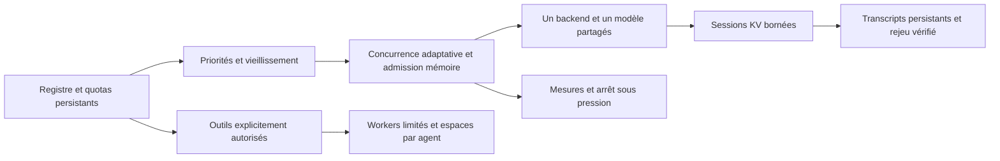

# Orchestrateur local générique — recherche

Cette extension est indépendante de RONIN. Elle ajoute un registre d'agents
logiques et un ordonnanceur autour d'un backend partagé, sans créer un modèle
par agent. La branche dépend de `research/airllm-next-5.1-2026-10-24` ; les
interfaces historiques et leurs paramètres par défaut sont conservés.

## Comptages

| Champ de `status()` | Signification |
|---|---|
| `registered_agents` | Identités enregistrées, avec ou sans travail |
| `active_agents` | Identités qui possèdent un quantum ou un appel outil en cours |
| `waiting_agents` | Identités ayant du travail en file, hors actifs |
| `paused_agents` | Identités ayant du travail suspendu, hors actifs |
| `jobs_*` | Nombre de travaux par état ; un agent peut avoir plusieurs travaux |
| `inferences_in_flight` | Appels `backend.advance` réellement en cours |
| `peak_simultaneous_inferences` | Maximum observé de ces appels depuis cette ouverture |
| `kv_reserved_bytes` | Réservations des sessions en cours ou non libérées |

Les ensembles « attente » et « suspendus » peuvent se chevaucher lorsqu'un
agent a plusieurs travaux. Leur somme n'est pas le nombre d'agents enregistrés.
Un quantum natif peut inclure préremplissage, rejeu et décodage ; son compteur
n'est pas un compteur de kernels GPU en parallèle. Les métriques des outils
sont distinctes des inférences.

**Le backend natif annonce une capacité de 1**, sur le thread propriétaire du
modèle. Enregistrer 600 agents fournit donc jusqu'à 600 conversations logiques
ordonnancées autour d'une seule génération à la fois. Un autre backend doit
déclarer et réellement supporter sa capacité concurrente sur la même instance.
Le test synthétique à quatre appels ne démontre aucune capacité modèle/GPU.

## Architecture et budgets



Les priorités entières vieillissent avec l'attente ; l'ordre de séquence fait
tourner les travaux d'une même priorité. Le nombre de lanes commence à 1,
augmente après plusieurs quanta sains et reste borné par la capacité du backend,
la configuration, le budget KV global et la mémoire disponible après réserve.
La mémoire d'un transcript réserve à l'admission son entrée et sa sortie
maximale, avec une marge pour les objets Python. Le registre, les métriques,
les journaux, les écritures cumulées et les travaux retenus sont bornés.

Chaque quantum libère son KV. Les sessions persistantes sont des tokens et non
600 tableaux KV. Pour reprendre un modèle récurrent, l'adaptateur refait le
préremplissage puis les forwards unitaires, et contrôle chaque token déjà
commis. Aucun échantillonnage stochastique n'est ajouté. Des quanta courts
améliorent l'alternance, mais le rejeu peut fortement diminuer le débit.

La persistance emploie remplacement atomique, fsync, contrôle de schéma,
checksum et verrou exclusif. La reprise exige la même identité de backend,
les mêmes capacités et limites. Les travaux récupérés restent suspendus
jusqu'à `resume()` ou `resume_all()`. Les quotas de jobs et de tokens de sortie
réservés sont cumulatifs ; annuler ou oublier un travail ne les rembourse pas.
Le checksum détecte une corruption accidentelle et n'authentifie pas un fichier
écrit par un utilisateur hostile disposant des mêmes droits locaux.

La pression, le RSS et la croissance du swap sont échantillonnés, y compris
pendant les quanta. Une alerte bloque les nouveaux appels et demande un arrêt
coopératif entre forwards. Les tokens non commis du quantum sont abandonnés.
La reprise requiert une action explicite et un contrôle sain. Une libération
KV en échec conserve la réservation et impose la fermeture du propriétaire.
Un échec de journal bloque également la continuation.

Un kernel/forward déjà lancé n'est pas préemptible en Python : pour un arrêt
dur, lancer les inférences dans le processus possédé par `experiment_guard`.
La supervision échantillonne à 50 ms avec plafond RSS 2 Gio, réserve système
3 Gio et croissance swap maximale 128 Mio. Le swap est un compteur système,
donc une autre application peut provoquer un arrêt conservateur. Les limites
d'allocation natives continuent d'appliquer leurs propres plafonds.

## API

Le modèle doit déjà exister et être ouvert dans un processus supervisé :

```python
from airllm.nextgen import (
    LocalOrchestrator, OrchestratorConfig, NativeModelBackend,
    ToolBroker, ToolLimits,
)

backend = NativeModelBackend(model)  # UNE instance existante
config = OrchestratorConfig(
    max_agents=1024, max_jobs=1024, max_concurrency=4,
    kv_budget_bytes=model.options.kv_bytes, quantum_tokens=8,
)
with LocalOrchestrator(backend, 'state/agents', config) as agents:
    for index in range(600):
        agent_id = f'agent-{index}'
        agents.register(agent_id, token_quota=512, job_quota=4)
        # Utiliser le tokenizer et le template propres au checkpoint.
        agents.submit(agent_id, prompt_ids[index % len(prompt_ids)], max_tokens=16)
    while agents.status()['jobs_queued'] and not agents.status()['stopped_reason']:
        agents.step()
    print(agents.status())
```

Ce premier exemple ouvre un nouvel état. À la réouverture du même répertoire,
les identités sont déjà enregistrées ; consulter `agent_snapshot()` et les jobs
récupérés, puis les reprendre explicitement sans refaire `register()`.
Le contrôleur peut créer des sous-agents via `register`/`submit`, dans les mêmes
plafonds. Le modèle n'obtient pas implicitement le droit de créer des processus,
d'accéder au réseau ou de lancer un shell.

Pour intégrer un autre moteur local, fournir un objet unique avec `identity`,
`max_concurrency`, `concurrent_safe`, `kv_bytes_per_session`,
`advance(InferenceRequest, max_tokens) -> InferenceResult` et `release(job_id)`.
Un hook `validate(request)` peut vérifier vocabulaire et contexte avant toute
admission. `token_ids` ne contient que les nouveaux tokens ; le résultat doit
avancer ou terminer le travail. Le backend doit respecter `stop_event`, ses
réservations KV et ses plafonds d'allocation. Une capacité déclarée ne peut pas
être vérifiée automatiquement par le contrôleur ; elle fait partie du contrat
de l'adaptateur de confiance. Ne pas déclarer plusieurs lanes si le moteur les
sérialise en interne. Fournir `first_token_seconds` permet une TTFT exacte ;
sinon la TTFT est marquée comme borne supérieure du premier quantum terminé.

```python
# Dans le même processus supervisé, avec l'orchestrateur encore ouvert :
agents.register('writer', tools=('write_text', 'read_text'))
with ToolBroker('state/tools', ToolLimits(max_workers=2)) as broker:
    broker.register('writer', allowed_tools=('write_text', 'read_text'), max_calls=8)
    result = agents.execute_tool('writer', broker, 'write_text',
                                 {'path': 'notes.txt', 'text': 'Résultat validé'})
```

Les droits sont requis dans les deux registres. Les outils disponibles sont
`read_text`, `write_text`, `list_files`. Les quotas d'appels survivent au
redémarrage, y compris un appel interrompu ; aucune écriture n'est rejouée
automatiquement. Les workers ont un environnement nettoyé, un répertoire
propre à l'agent, un délai maximal et des plafonds d'entrée/sortie/fichiers.
Traversées, liens symboliques et liens physiques sont refusés. Le broker
plafonne aussi le nombre global de workers. Cette isolation de capacités
n'est pas une sandbox système pour exécuter du code hostile. Aucun texte
produit par le modèle n'est automatiquement exécuté comme outil.

## Reproduction

Python 3.12 et les dépendances de validation du dépôt sont requis. Aucun script
ci-dessous ne télécharge de checkpoint. Dans un checkout dédié :

```bash
export PYTHONPATH=air_llm
export HF_HUB_OFFLINE=1 TRANSFORMERS_OFFLINE=1 MLX_ENABLE_TF32=0
python -m pytest tests_next/test_orchestrator.py tests_next/test_orchestrator_native.py tests_next/test_agent_tools.py -q
python benchmarks/run_orchestrator_guarded.py --mode synthetic --output work/synthetic.json
python benchmarks/run_orchestrator_guarded.py --mode smollm --model /chemin/local/SmolLM2-135M-Instruct --output work/smollm.json
python benchmarks/run_orchestrator_guarded.py --mode qwen-gguf --model /chemin/local/modele.gguf --counts 1 --tokens 2 --output work/qwen.json
python benchmarks/probe_orchestrator_resume.py --model /chemin/local/SmolLM2-135M-Instruct --output work/resume
python benchmarks/analyze_orchestrator.py work/synthetic.json work/smollm.json --output work/summary.csv
```

Les charges par défaut sont 1/10/100/500/600 agents, deux tokens demandés,
trois prompts cycliques, priorités 0/1/2 et journaux réellement écrits. Les
tokens des exécutions entraînées sont confrontés à `model.generate()` ordinaire.
Les réponses sont volontairement très courtes et souvent tronquées ; il s'agit
de charge et d'isolation, pas d'une évaluation de qualité d'assistant.
Le temps de charge inclut enregistrement, admission et drain, mais exclut
chargement du modèle et références. Le guard fournit séparément le temps du
processus entier. Les sources sont hashées avant/après la campagne ; une
modification la rend interrompue. Les sorties partielles restent conservées.

Les résultats, limites et fichiers de preuves sont détaillés dans
[ORCHESTRATOR_REPORT_FR.md](../../ORCHESTRATOR_REPORT_FR.md).

L'archive de 42 fichiers a été restaurée avec vérification de chaque SHA-256 ;
sa réanalyse reproduit le CSV publié octet pour octet :

```bash
python benchmarks/restore_orchestrator_evidence.py --archive research/orchestrator/evidence.tar.gz --manifest research/orchestrator/evidence-manifest.json --destination work/preuves-restaurees
python benchmarks/analyze_orchestrator.py work/preuves-restaurees/synthetic-final.json work/preuves-restaurees/smollm-final.json work/preuves-restaurees/qwen-validated.json --output work/summary-restaure.csv
```
